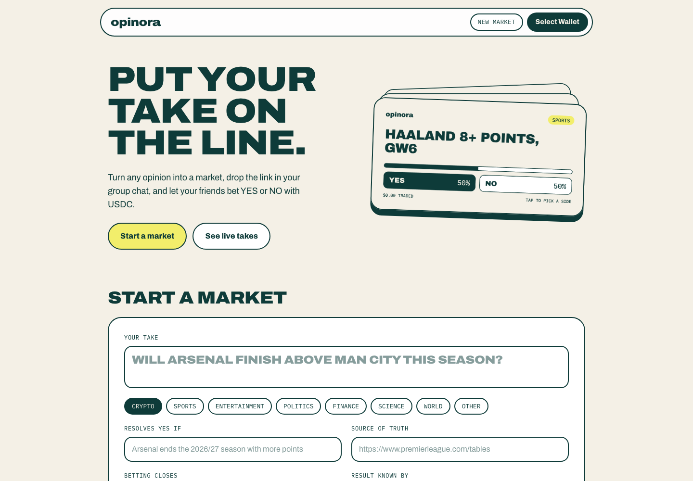
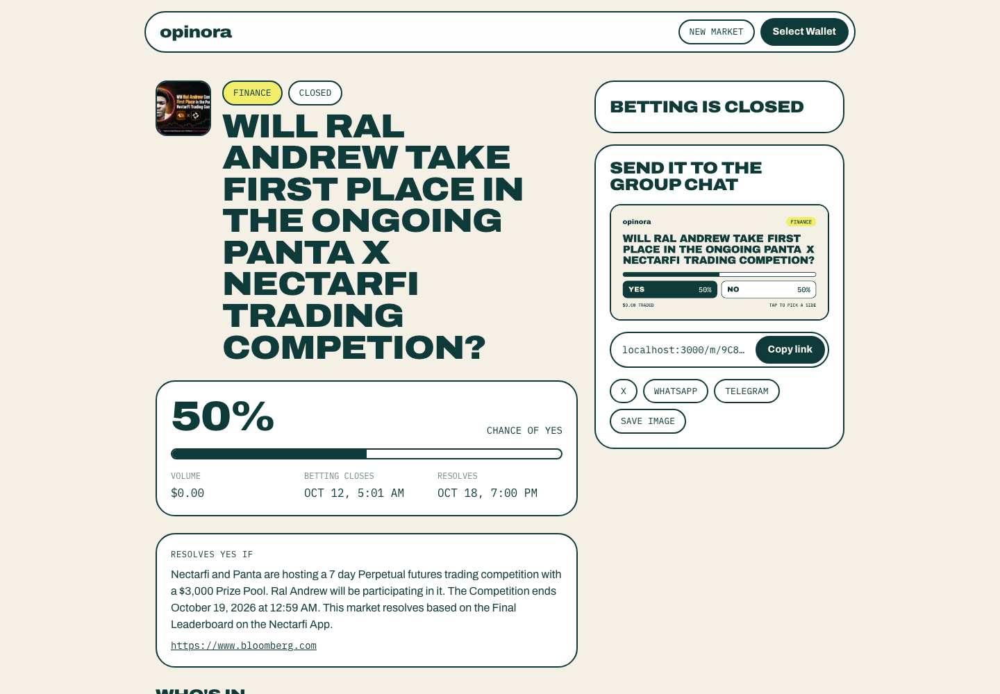

# Opinora

Your group chat argues about everything: who wins Sunday, whether SOL breaks $300, if the new album flops. Then the argument scrolls away and nobody is ever proven right. Opinora turns a take into a real prediction market in under a minute. You get a link and a card to drop in the chat, your friends pick YES or NO with USDC, and the market settles the argument.

Built on the [Panta API](https://docs.panta.market/) for the Colosseum Crypto World's Fair Panta Sidetrack.

| Home | Market |
| --- | --- |
|  |  |

## What it does

- **Create a market** from a question, a YES rule, a source of truth and two dates. Opinora draws a square card for it, uploads it to Panta's image signer, and the creator signs one transaction with Phantom or Solflare.
- **Share it** with a link that unfurls as a market card on X, WhatsApp, Telegram and iMessage, or save a story-size image.
- **Pick a side** on the market page: live odds, volume, the resolution rule, and a feed of every trade linked to Solscan.

## How Panta is used

| Flow | Panta endpoints |
| --- | --- |
| Market image | `POST /markets/create/image-upload/` (signed Cloudinary upload) |
| Create market | `POST /markets/create/quote/`, `/markets/create/build/`, `/markets/register/` |
| Buy YES/NO | `POST /primaryorderquote/`, `/primaryorderbuild/`, `/primaryordersubmit/` |
| Trade attribution | `POST /trades/` |
| Discovery | `GET /markets/`, `/markets/{id}/`, `/markets/{id}/trades/` |

The API key stays on the server. Every transaction is signed in the user's wallet, and Opinora never holds keys or funds. Market cards and link previews are rendered on the server with `next/og`.

## Run it

```bash
npm install
echo "PANTA_API_KEY=your_key" > .env.local
npm run dev
```

Get a key from the [Panta dashboard](https://www.panta.market/). The API and Solana RPC URLs live in `src/lib/config.ts`.

Stack: Next.js 16, React 19, Tailwind 4, Solana wallet adapter.
